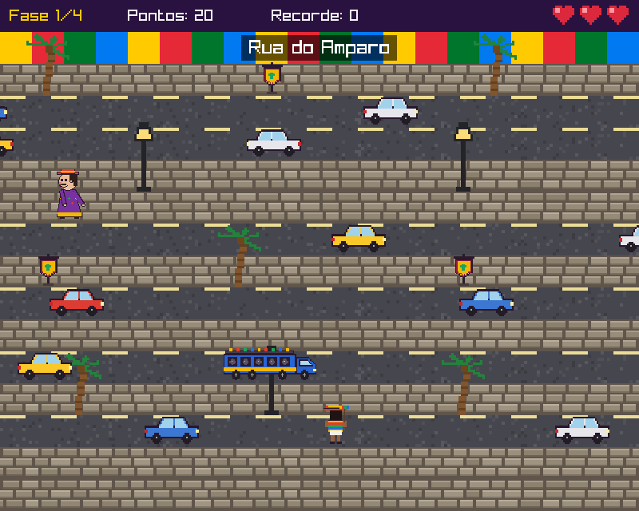
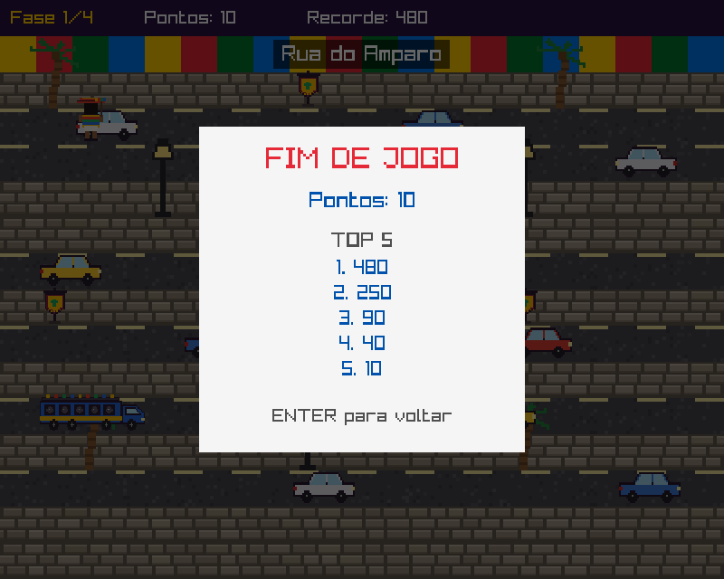

# Corre, Folião!

Casual game em C com Raylib ambientado no Carnaval de Olinda. Projeto da disciplina Programação Imperativa e Funcional (PIF) — CESAR School, 2026.2.

<p align="center">
  
  
  
</p>

## Vídeo

[](https://youtu.be/9uHPenxZqtA)

Assista no YouTube: https://youtu.be/9uHPenxZqtA

## O jogo

O folião precisa atravessar quatro pontos do Carnaval de Olinda para chegar no bloco:

1. Rua do Amparo
2. Ladeira da Misericórdia
3. Alto da Sé
4. Quatro Cantos

Cada fase é uma tela com ruas e ladeiras. Carros e trios elétricos passam nas ruas, bonecos gigantes passam nas ladeiras, e coqueiros, postes e estandartes bloqueiam o caminho. Chegando na faixa colorida do topo, o folião passa para a próxima fase, com mais obstáculos e mais rápidos.

- O folião começa com **3 vidas**. Bateu em um obstáculo, perde uma vida e volta ao começo da fase.
- **+10 pontos** a cada linha nova alcançada e **+100** a cada fase completada.
- Os **5 melhores placares** ficam salvos no arquivo `scores.txt`.

## Controles

| Tecla | Ação |
|---|---|
| Setas | Andar |
| ENTER | Começar / voltar ao menu |
| P | Pausar |
| ESC | Sair |

## Como compilar e rodar

É preciso ter a [Raylib](https://www.raylib.com/) instalada.

**Windows** (Raylib instalada em `C:\raylib`):

```
C:\raylib\w64devkit\bin\make.exe run
```

**Linux:**

```
make run
```

## Estrutura

```
corre-foliao/
├── Makefile
├── include/          cabeçalhos (.h)
├── src/
│   ├── main.c        janela, loop principal e troca menu/jogo
│   ├── menu.c        tela de título
│   ├── fase.c        matriz das fases e desenho do cenário
│   ├── jogador.c     movimento e animação do folião
│   ├── obstaculo.c   lista encadeada de carros, trios e bonecos
│   ├── jogo.c        regras: vidas, pontos, fases, pausa e fim
│   └── recordes.c    top 5 salvo em arquivo
└── assets/           imagens do cenário, folião, veículos e bonecos
```

## Requisitos da disciplina

| Requisito | Onde está |
|---|---|
| Structs | `struct Jogador`, `struct Node` e `struct Jogo` |
| Ponteiros | Funções recebem `struct Jogo *` e `struct Jogador *`; `struct Node **head` |
| Alocação dinâmica | `malloc` em `CriarNo` e `free` em `LiberarLista` (`obstaculo.c`) |
| Lista encadeada | Obstáculos da fase em uma lista de `struct Node` ligada por `next` |
| Matrizes | `fases[4][15][21]` com o mapa das fases; matrizes de sprites |
| Arquivo | Top 5 lido e salvo em `scores.txt` (`recordes.c`) |

## Equipe

- Eduardo Esteves De Albuquerque
- Guilherme Melo Caldas de Lira
